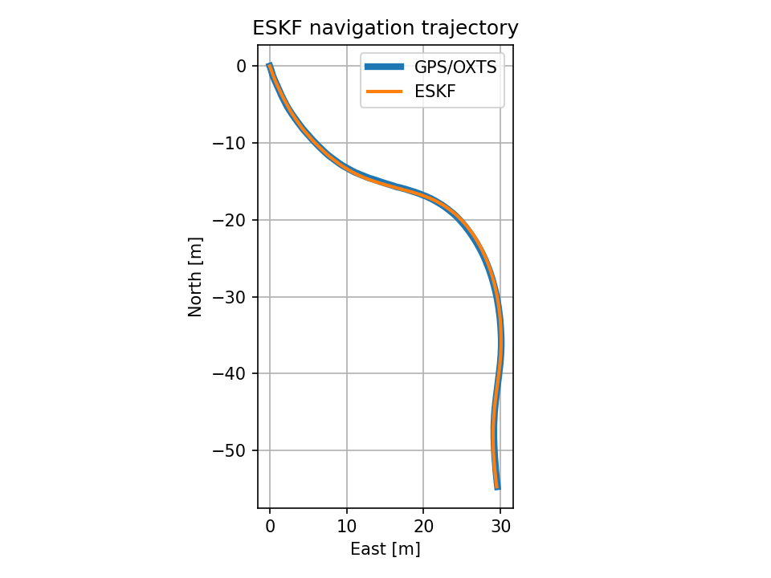

# KITTI Navigation, Perception & Local Planning

KITTI 데이터로 navigation, perception, local planning을 공부하면서 구현하는 레포.
각각 따로 구현한 뒤, 추정한 차량 위치와 주변 장애물을 이용해 지역 경로를 만드는 것까지 연결해보려고 한다.

KITTI Raw `2011_09_26_drive_0005_sync`로 GPS/IMU ESKF 궤적과 LiDAR 지면 제거·장애물 군집화를 확인했다. Local planning은 아직 시작 전이다.

```text
load_file.py          # KITTI 공통 로더
navigation/           # GPS/IMU ESKF
perception/           # LiDAR 전처리, 지면 제거, 군집화
local_planning/       # 지역 경로 계획 예정
results/navigation/   # 실행 결과와 plot.py
```

## 실행 환경

```bash
python3 -m venv .venv
source .venv/bin/activate
python -m pip install numpy pandas matplotlib Pillow pykitti scipy pymap3d open3d
```

데이터는 KITTI Raw의 synced 데이터를 사용했다. Calibration 파일도 따로 받아 날짜 폴더 안에 같이 넣어야 한다.

```text
data/
└── 2011_09_26/
    ├── calib_cam_to_cam.txt
    ├── calib_imu_to_velo.txt
    ├── calib_velo_to_cam.txt
    └── 2011_09_26_drive_0005_sync/
        ├── oxts/
        ├── image_00/
        ├── image_01/
        ├── image_02/
        ├── image_03/
        └── velodyne_points/
```

압축을 풀었을 때의 하위 폴더와 timestamps 파일은 그대로 유지한다. 다른 시퀀스는 `KittiLoader(date=..., drive=...)`로 지정할 수 있다.

프로젝트 루트에서 실행:

```bash
python load_file.py --frame 0 --lidar
python -m navigation.run_eskf
python results/navigation/plot.py --show
```

결과는 `results/navigation/`에 저장된다. 그래프 창 없이 저장만 하려면 `--show`를 빼면 된다.

## Navigation

IMU로 위치·속도·자세를 예측하고, GPS 위치로 보정하도록 구성했다. 첫 GPS 위치를 ENU 원점으로 잡고 자세는 quaternion으로 관리한다. 초기화와 수식, 결과 컬럼은 [navigation/README.md](navigation/README.md)에 정리했다.

현재 그래프는 ESKF 결과와 보정에 넣은 OXTS 위치를 비교한 것이다. OXTS 자체가 GPS/IMU 융합 장비의 출력이라, 이 차이를 실제 위치 오차로 보지는 않고 있다.



## Perception

`KittiLoader`로 LiDAR를 읽고 관심 영역 추출, voxel downsampling, RANSAC 지면 제거, DBSCAN 군집화와 bounding box 추출을 구현했다. 첫 프레임에서 지면과 남은 점을 시각화했고, 추정 평면 기울기는 약 0.3°였다. 실행 방법과 남은 작업은 [perception/README.md](perception/README.md)에 정리했다. 

## 다음에 할 것

- 지면 제거 후 점들로 BEV 점유 격자 만들기
- 장애물과 목표 경로를 같은 차량 좌표계로 정리
- Local planning 연결
- Navigation은 GPS 중단 시 드리프트와 이상치 처리도 확인
